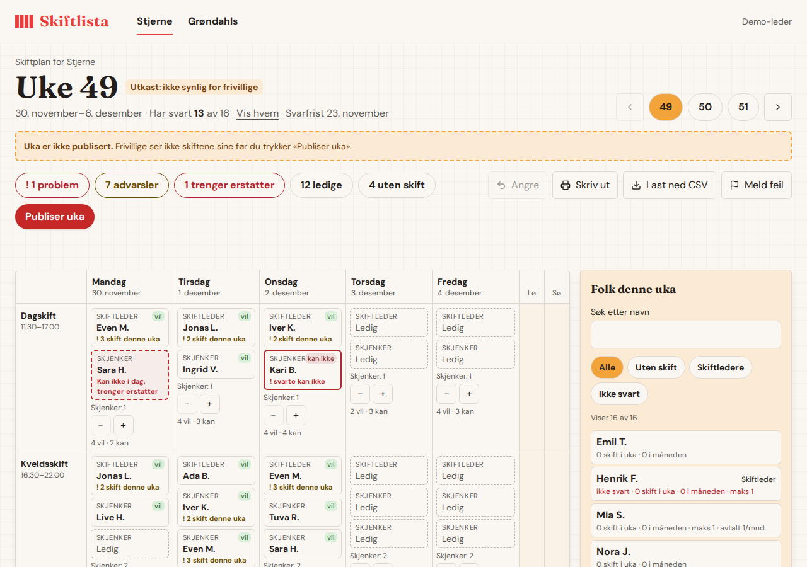
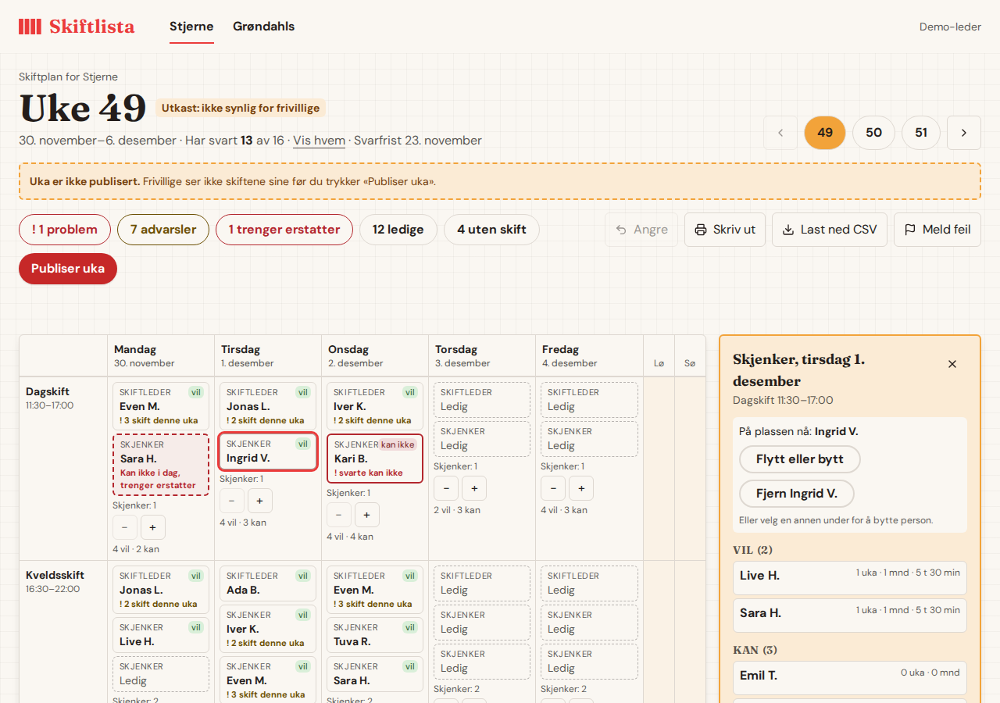

# Slik planlegger du uka

For deg som er leder i Skiftlista. Bildene er tatt med oppdiktede navn.

## 1. Velg bar og uke

Baren velger du øverst (Stjerne, Grøndahls …), og uka med 49, 50, 51 eller
pilene. Under uketittelen står hvor mange som har svart på ønsker. «Vis hvem»
viser hvem som ikke har svart.

**Uka er et utkast til du publiserer den.** Så lenge det står «Utkast: ikke
synlig for frivillige», ser ingen av de frivillige noe du gjør.

## 2. Se hva som må gjøres

Knappene under uketittelen er en huskeliste. Trykk på en for å se hvor:

- **problem** (rød): noe er galt, for eksempel at noen sa «kan ikke» og er satt
  opp likevel.
- **advarsler** (gul): verdt å se på, for eksempel tredje skift samme uke.
- **trenger erstatter**: en som skulle jobbe har meldt at de ikke kan (sykdom).
- **ledige**: plasser som må fylles. **uten skift**: folk som ikke har fått noe.

Trykk på en dag (for eksempel «Mandag») for å se hvem som vil og kan akkurat
den dagen.

## 3. Sett folk opp

1. Trykk på en plass i rutenettet. Til høyre (på mobil: nederst) kommer en
   liste med folk sortert etter hva de har svart: **vil**, **kan**,
   **ikke svart** og **kan ikke**.
2. Trykk på et navn for å sette personen på plassen. Du ser timer og antall
   skift personen allerede har i uka og måneden.
3. Gjort feil? Trykk **Angre** (eller Ctrl+Z). Du kan angre flere steg.

**Rød advarsel i en dialog.** Hvis personen mangler det plassen krever, eller
har svart «kan ikke», spør Skiftlista først. Les advarselen. «Avbryt» er
valgt fra start; «Sett inn likevel» er ditt valg. Aldersgrensen på Halvtimen
kan ikke overstyres.

**Kopier fra forrige uke.** Knappen setter forrige ukes folk på de samme
plassene (samme dag, skift og rolle). Den spør først. Bare **tomme** plasser
fylles, og ingen blir fjernet eller byttet ut. Folk som har svart «kan ikke»,
som ikke er med i gruppa lenger, eller som reglene ikke tillater (for eksempel
mangler godkjenning), hoppes over og listes opp i meldingen, slik at du kan ta
dem selv. Kopieringen er alt eller ingenting. Ble det feil, trykk **Angre**
(eller Ctrl+Z): da tas alle som ble kopiert av igjen, bortsett fra de du har
flyttet siden. Under hvert skift står det hvem som har sagt «vil» og «kan», og
med piltastene flytter du mellom plassene.

**På mobil** vises én dag om gangen. Velg dag i stripen over tabellen. Du kan
bytte dag midt i «Flytt eller bytt» og flytte noen til en annen dag.

## 4. Bytte, flytte, ta bort og sykedager

- **Bytte person på en plass:** trykk på plassen og velg en annen i listen.
- **Flytte eller bytte to personer:** trykk på plassen, så **Flytt eller
  bytt**, og trykk deretter på plassen de skal til. Er den opptatt, bytter de
  to plass.
- **Ta bort:** trykk på plassen og velg **Fjern …**.
- **Sykdom:** en plass der personen har meldt «kan ikke i dag» har rød stiplet
  ramme og teksten «trenger erstatter». Trykk på den og velg en erstatter.
  Personen går av plassen når erstatteren settes inn.
- **Ønsker bytte:** står det «Ønsker bytte» på en plass, har personen bedt om
  å bytte. Trykk på plassen og finn en annen.

## 5. Flere eller færre plasser

Under hver dag står **Skjenker: 2** med **−** og **+**. Bruk **+** når det blir
travelt, og **−** for å ta bort en ledig plass. Du kan ikke ta bort en plass
som er besatt, og skiftleder legges ikke til eller fjernes her.

## 6. Publiser

Når uka ser riktig ut, trykk **Publiser uka**. **De frivillige ser skiftene
sine i mobilappen med en gang.**

- Endrer du noe etter publisering, blir uka gul («endret etter publisering»),
  og de frivillige ser endringen med en gang. Trykk **Publiser uka** igjen når
  du er ferdig, så er det registrert.
- **Gjør til utkast** tar uka bort fra de frivillige. Den spør først. Bare
  kommende uker kan gjøres til utkast.
- Publisering kan ikke angres med «Angre». Bruk **Gjør til utkast**.

## 7. Send eller ta vare på uka

- **Last ned CSV** lager en fil du kan åpne i Excel eller Google Sheets, én
  rad per plass. Under piloten limer du den inn i Excel-arket hver uke.
- **Skriv ut** gir en utskrift på A4.

## Når noe ikke virker

Trykk **Meld feil**, skriv hva som skjedde, og send. Ikke skriv navn på
frivillige. Står det «ikke sendt», skriv i Slack-kanalen for piloten. Prøv å
laste siden på nytt først. Kommer du ikke inn, bruk den eldre siden `/shifts` i
Personal, og si fra.

## Det som ikke finnes ennå

Forslag til hvem som bør settes opp (automatisk fordeling), varsler til deg
når noen ber om bytte eller melder sykdom, og påminnelse til dem som ikke har
sendt ønsker. Opplæring og kurs vises ikke som egne skjermer for ledere.
